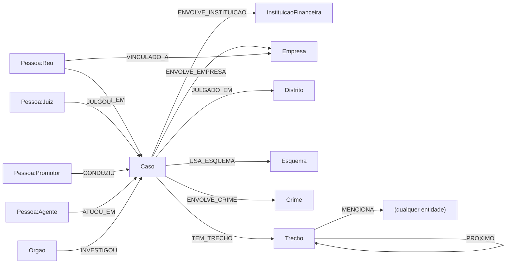

# GraphRAG / KAG — Dados Grafos (Dados Financeiros (Fraudes))

Projeto Final da disciplina **Tendências em Ciência da Computação** (UNIPÊ), prof. Ricardo Roberto.
Sistema de perguntas e respostas sobre **casos reais de fraude financeira**. O sistema usa um **grafo de conhecimento no Neo4j**, construído a partir de textos não estruturados, e busca **híbrida** (vetorial + textual + grafo). A resposta mostra de onde veio cada informação: a consulta Cypher, os trechos, o subgrafo e um nível de confiança.

**Equipe:** Max Cavalcante · Bruno Dutra · Hiago Kalil · Vitor Nóbrega · Lucas Lopes

| Fase | Conteúdo | Situação |
|---|---|---|
| 1 | Proposta, dataset, modelo LPG, schema no Neo4j | ✅ |
| 2 | Text-to-Graph: NER, extração de relações, resolução de entidades, anonimização, ingestão | ✅ |
| 3 | GraphRAG/KAG: Text2Cypher, busca híbrida (RRF), multi-hop, PageRank, Louvain, menor caminho, mitigação de alucinação, avaliação | ✅ |
| 4 | Interface Streamlit, artigo (SBC) e apresentação | ✅ |

---

## 1. Estudo de caso e dataset

| Item | Definição |
|---|---|
| Estudo de caso | Dados Grafos (Dados Financeiros (Fraudes)) |
| Fonte | [Department of Justice 2009–2018 Press Releases](https://www.kaggle.com/datasets/jbencina/department-of-justice-20092018-press-releases) (Kaggle, licença **CC0 – domínio público**), comunicados oficiais do Departamento de Justiça dos EUA |
| Tamanho | **13.087** comunicados, de 05/01/2009 a 27/07/2018 |
| Campos | `id`, `title`, `contents` (texto completo), `date`, `topics`, `components` |
| Recorte | **1.106** comunicados candidatos de fraude financeira |

**Por que este dataset:** são **casos reais** e o texto é **livre** (matéria-prima para NER/RE). Os textos citam réus, bancos, esquemas, órgãos investigadores, distritos, penas e valores, o que permite consultas **multi-hop**.

**Critério do recorte** (`scripts/analisar_dataset.py`): o comunicado entra se cumprir pelo menos um destes:
- tem um tópico financeiro (*Financial Fraud*, *Mortgage Fraud*, *Securities, Commodities & Investment Fraud*);
- o texto cita *bank fraud*, *Bank Secrecy Act* ou *mortgage fraud*;
- o título cita banco, lavagem, Ponzi, fraude de valores, *wire fraud*, hipoteca, empréstimo, cartão etc.

O campo `topics` está vazio em 64% dos comunicados, por isso o recorte não depende só dele. O recorte ainda tem ruído; na Fase 2 o LLM classifica cada comunicado antes da extração.

**Seleção para o grafo** (`fase2.py selecionar`): pela cota gratuita do LLM, **200** comunicados do recorte (até 12 mil caracteres), priorizando os que citam instituições financeiras mencionadas também em outros comunicados, o que cria ligações entre casos.

**O que o recorte contém** (contagem por padrão de texto, portanto aproximada):

| Informação | Comunicados |
|---|---|
| Valores em US$ milhões/bilhões | 747 |
| Promotor citado / juiz citado | 763 / 520 |
| FBI / IRS / SEC / HUD-FHFA | 567 / 482 / 173 / 94 |
| Confissão de culpa / denúncia / condenação | 578 / 527 / 271 |
| Coréus ou cúmplices | 528 |
| Esquema hipotecário | 330 |
| Restituição / confisco | 253 / 244 |
| Número de lei (`U.S.C.`) | **8**, raro, por isso nenhuma pergunta depende dele |

Particularidades que influenciaram o modelo: **44** comunicados sem `id` e **3** `id` repetidos. Por isso o projeto gera a própria chave (`caso_id`).

## 2. Privacidade e anonimização

- **Toda pessoa vira código:** `Reu_001`, `Juiz_001`, `Promotor_001`, `Agente_001`. A mesma pessoa recebe sempre o mesmo código.
- **Organizações mantêm o nome real:** bancos, empresas e órgãos.
- **Não são guardados** idade nem cidade de réus (risco de reidentificação).
- A tabela *nome real → código* fica **só local** (`data/private/`, no `.gitignore`). O grafo e o repositório contêm apenas códigos.

## 3. Redução de ruído na extração (Fase 2)

1. **Filtro de relevância:** na mesma chamada da extração, o LLM diz se o comunicado é sobre fraude financeira; os que não são (8 de 200) são descartados.
2. **Esquema fechado:** o LLM (Gemini, temperatura 0) só pode devolver o JSON do modelo Pydantic `Extracao` (`scripts/f2_esquema.py`): tipos, papéis, desfechos, esquemas e crimes de vocabulário controlado.
3. **Frase de evidência obrigatória e verificada:** cada item traz a frase exata; o código descarta o item se a frase não estiver no comunicado.
4. **Resolução de entidades:** normalização de nomes (sem N.A., Inc., Corp., LLC…) e regras de unificação (ex.: *Bank of America, N.A.* = *Bank of America Corporation*; *IRS Criminal Investigation* = *Internal Revenue Service*; *Justice Department* = *Department of Justice*).
5. **Anonimização:** nome completo e sobrenome de cada pessoa extraída viram o código no texto, nos trechos e nas evidências, preservando palavras de nomes de organizações (ex.: *Wells* em *Wells Fargo*).
6. **Medição:** `scripts/f2_anotacao.py` sorteia 10 comunicados (semente fixa) e gera a planilha `data/private/anotacao_manual.xlsx` (130 itens) para o grupo marcar certo/errado e anotar o que faltou; `--medir` calcula precisão e revocação.

**Resultado da verificação automática de evidência** (`data/interim/relatorio_fase2.json`):

| Tipo | Extraídos | Evidência confirmada | Taxa |
|---|---|---|---|
| Réus | 361 | 340 | 94% |
| Instituições financeiras | 381 | 375 | 98% |
| Empresas | 162 | 160 | 99% |
| Órgãos | 757 | 741 | 98% |
| Juízes | 87 | 87 | 100% |
| Promotores | 469 | 461 | 98% |
| Agentes | 580 | 579 | 100% |
| **Total** | **2.797** | **2.743** | **98%** |

## 4. Perguntas que o sistema deve responder

| # | Pergunta (modelo) | Tipo |
|---|---|---|
| 1 | Quais casos envolvem o banco X? | Consulta direta |
| 2 | Quais órgãos investigaram o caso Y? | Consulta direta |
| 3 | Que outros réus cometeram fraude contra o mesmo banco do caso Y? | Multi-hop (3 saltos) |
| 4 | Que outros casos o promotor do caso X conduziu, e quais envolvem lavagem? | Multi-hop (3) |
| 5 | O Réu_NNN tem coréus que aparecem em outros casos? | Multi-hop (3–4) |
| 6 | Em quais distritos aparece fraude hipotecária investigada pelo HUD/FHFA? | Multi-hop (2–3) |
| 7 | Quais bancos aparecem em casos investigados por FBI e IRS juntos, e qual o valor total? | Multi-hop + agregação |
| 8 | Quais grupos de casos, réus e bancos existem, e qual esquema predomina em cada um? | Louvain |
| 9 | Quais bancos e órgãos são mais centrais na rede de casos? | PageRank |
| 10 | Qual o caminho mais curto entre o banco A e o banco B? | Shortest Path |
| 11 | "Casos de Ponzi contra investidores idosos": réus e penas? | Híbrida (vetor + grafo) |
| 12 | Que penas foram aplicadas em casos parecidos com o caso X? | Híbrida (vetor + grafo) |
| 13 | Como evoluiu o número de casos de lavagem por ano? | Agregação temporal |
| 14 | Qual o valor de restituição e confisco por tipo de esquema? | Agregação |
| 15 | Pergunta sem resposta no grafo (ex.: casos de 2022) | Teste anti-alucinação |
| 16 | Pergunta com premissa falsa | Teste anti-alucinação |

Na avaliação (seção 9), perguntas concretas com gabarito tirado do grafo por Cypher comparam **GraphRAG × RAG só vetorial × LLM sem contexto**.

## 5. Modelo LPG



**Nós**

| Rótulo | Chave | Propriedades principais |
|---|---|---|
| `Caso` | `caso_id` | `doj_id`, `titulo`, `data`, `ano`, `topicos`, `componentes`, `texto_anon`, `valor_esquema_usd`, `embedding` |
| `Trecho` | `trecho_id` | `caso_id`, `ordem`, `texto`, `embedding` |
| `Pessoa:Reu` / `:Juiz` / `:Promotor` / `:Agente` | `codigo` | somente o código |
| `InstituicaoFinanceira` | `nome` (normalizado) | `nome_exibicao`, `aliases`, `tipo` |
| `Empresa` | `nome` | `nome_exibicao`, `aliases` |
| `Orgao` | `nome` | `sigla`, `tipo` |
| `Distrito` | `nome` | — |
| `Esquema` / `Crime` | `nome` | vocabulário controlado |

Os algoritmos gravam `comunidade` (Louvain) e `pagerank` nos nós.

**Relações**

| Relação | De → Para | Propriedades |
|---|---|---|
| `REU_EM` | Reu → Caso | `desfecho`, `pena_meses`, `restituicao_usd`, `confisco_usd` |
| `JULGOU` / `CONDUZIU` / `ATUOU_EM` | Juiz / Promotor / Agente → Caso | — |
| `INVESTIGOU` | Orgao → Caso | — |
| `ENVOLVE_INSTITUICAO` | Caso → InstituicaoFinanceira | `papel` (vítima, acusada, intermediária) |
| `ENVOLVE_EMPRESA` / `VINCULADO_A` | Caso → Empresa / Reu → Empresa | `papel` / — |
| `JULGADO_EM` | Caso → Distrito | — |
| `USA_ESQUEMA` / `ENVOLVE_CRIME` | Caso → Esquema / Crime | — |
| `TEM_TRECHO` / `PROXIMO` / `MENCIONA` | Caso → Trecho / Trecho → Trecho / Trecho → entidade | `ordem` |

**Procedência:** toda relação extraída do texto leva `evidencia` (frase exata), `trecho_id` e `metodo` (`llm`).

## 6. Schema no Neo4j

Arquivo: [`schema/schema.cypher`](schema/schema.cypher), com 24 comandos idempotentes.

| Tipo | Qtd. | Itens |
|---|---|---|
| Chave (`NODE KEY`) | 9 | `Caso.caso_id`, `Trecho.trecho_id`, `Pessoa.codigo`, `nome` de InstituicaoFinanceira, Empresa, Orgao, Distrito, Esquema, Crime |
| Existência | 3 | `Trecho.texto`, `Caso.titulo`, `REU_EM.evidencia` |
| Tipo | 2 | `Caso.data :: DATE`, `Caso.ano :: INTEGER` |
| **B-Tree** (no Neo4j 5 o tipo se chama `RANGE`) | 5 | `Caso.data`, `Caso.ano`, `Trecho.caso_id`, `REU_EM.desfecho`, `ENVOLVE_INSTITUICAO.papel` |
| **Fulltext** (analisador `english`) | 3 | `Trecho.texto`, `Caso.titulo`, nome das organizações |
| **Vector** (768 dim., cosseno) | 2 | `Trecho.embedding`, `Caso.embedding` |

**Validação** (`scripts/aplicar_schema.py`, rodada em banco vazio): 24/24 comandos aplicados, 14 constraints criadas, 10 índices ONLINE. As 6 tentativas de gravar dados inválidos foram recusadas (caso repetido, caso sem ID, data em texto, código de pessoa repetido entre papéis, trecho sem texto, `REU_EM` sem evidência). As buscas vetorial e fulltext funcionaram, e o banco terminou com 0 nós.

## 7. Decisões técnicas

| Item | Escolha |
|---|---|
| Banco | Neo4j **AuraDB Free** 5.27 (até 200 mil nós e 400 mil relações; apagado após 30 dias sem uso) |
| LLM | Google Gemini pelo SDK oficial `google-genai`, modelo **gemini-3.5-flash-lite** (o plano gratuito permite 500 pedidos/dia nos modelos Flash-Lite e só 20 nos Flash). Saída sempre em JSON validado por Pydantic. Tenta de novo em erros 429/500/503 |
| Embeddings | **gemini-embedding-001** com `output_dimensionality=768`, vetores normalizados (o índice usa cosseno). Multilíngue: perguntas em português, textos em inglês. Dispensa instalar PyTorch |
| Trechos | ~1.500 caracteres com 150 de sobreposição, cortados em fim de frase; vetor do caso = média normalizada dos trechos |
| Algoritmos | O AuraDB Free não tem GDS: PageRank e Louvain rodam em Python (networkx) e são gravados nos nós (`pagerank`, `comunidade`); o menor caminho usa `shortestPath` do Cypher |
| Segurança do Text2Cypher | Bloqueio de CREATE/MERGE/SET/DELETE/CALL…, comando único, LIMIT obrigatório e execução em **transação de leitura** com timeout |
| Certificados | `truststore` em `scripts/conexao.py`: o Python passa a validar o certificado do Aura com os certificados do sistema operacional (corrige `CERTIFICATE_VERIFY_FAILED` em alguns Windows) **sem desligar a verificação** |

## 8. Arquitetura GraphRAG/KAG (Fase 3)

Cada pergunta usa duas chamadas ao LLM (`scripts/graphrag.py`):

1. **Ligação de entidades:** nomes com inicial maiúscula → índice fulltext de organizações; `DOJ-00025`, `Reu_001` → regex.
2. **Plano (forma lógica, lado KAG):** o LLM recebe o schema e as entidades e devolve uma consulta Cypher somente leitura + termos de busca em inglês.
3. **Busca híbrida:** vetorial (`trecho_embedding_vec`) + fulltext/BM25 (`trecho_texto_ft`), fundidas por **Reciprocal Rank Fusion**.
4. **Expansão multi-hop:** casos encontrados → réus, desfechos, instituições e papéis, órgãos, distrito, esquemas, crimes → outros casos com a mesma instituição.
5. **Resposta fundamentada:** só com o contexto numerado; cada frase cita `[ID]`.
6. **Verificação:** citações inexistentes são removidas; sem contexto ou sem citação válida → *"não encontrado"*. A **confiança** (alta/média/baixa) combina frases com citação, precisão das citações, retorno do Cypher e similaridade do melhor trecho.

## 9. Resultados

**Grafo** (após a Fase 2): 192 casos válidos, 936 trechos, 979 pessoas (241 réus, 64 juízes, 309 promotores, 365 agentes), 134 instituições financeiras (37 aparecem em 2+ casos), 118 empresas, 151 órgãos, 40 distritos, 12 esquemas e 12 crimes: 2.574 nós e 7.998 relações.

**Algoritmos** (`scripts/f3_algoritmos.py`, projeção com 1.574 nós e 2.700 arestas, um único componente conexo):

| PageRank | Instituição | Casos |
|---|---|---|
| 1 | UBS AG | 61 |
| 2 | Bank of America Corporation | 21 |
| 3 | Wells Fargo & Company | 18 |
| 4 | J.P. Morgan Chase & Co. | 16 |
| 5 | Credit Suisse | 15 |

- **Louvain:** 33 comunidades, modularidade 0,752. Exemplos: bancos suíços e contas offshore (UBS, Wegelin); manipulação da LIBOR (Barclays, RBS, Rabobank, DB Group Services); hipotecas (Bank of America, Countrywide, Wachovia, Ally).
- **Menor caminho** UBS AG → Bank of America: 2 saltos, pelo caso das intimações do IRS sobre contas no Belize Bank.

**Avaliação** (`scripts/f3_avaliacao.py`): 27 perguntas com gabarito tirado do grafo por Cypher (9 de fato simples, 4 de agregação, 9 multi-hop) + 5 sem resposta no corpus (bancos fictícios), respondidas pelos três sistemas com o mesmo LLM. Os casos são citados pelo título do comunicado. Acerto = F1 das entidades (listas) ou acerto binário (contagem, desfecho); alucinação = respondeu e trouxe entidade fora do gabarito, número errado, nenhum item certo, ou respondeu pergunta sem resposta.

| Sistema | Acerto | Alucinação | Abstenção |
|---|---|---|---|
| **GraphRAG (proposto)** | **96%** | **4%** | 18% |
| RAG só vetorial | 60% | 15% | 41% |
| LLM sem contexto | 18% | 0% | 100% |

| Acerto por tipo | GraphRAG | RAG vetorial | LLM sem contexto |
|---|---|---|---|
| Fato simples (9) | 100% | 84% | 0% |
| Agregação (4) | 100% | 0% | 0% |
| Multi-hop (9) | 87% | 40% | 0% |
| Sem resposta (5) | 100% | 100% | 100% |

O LLM sem contexto recusou todas as perguntas (0% de alucinação, mas nenhuma resposta útil). A única alucinação do GraphRAG foi citar o DOJ de forma genérica entre os órgãos de casos do Bank Leumi, cujo gabarito lista a Divisão Tributária do DOJ. O corretor automático foi auditado resposta a resposta; dois erros dele foram consertados antes dos números finais, com as mesmas regras para os três sistemas.

**Qualidade da extração:** conferência item a item de 10 comunicados sorteados (130 itens): precisão de 91% (118/130) e revocação aproximada de 91% (11 entidades não extraídas). A conferência foi uma pré-anotação feita por outro modelo (Claude), com critérios explícitos, para revisão do grupo.

**Artigo** (modelo SBC): [`docs/artigo_sbc_graphrag_fraude.pdf`](docs/artigo_sbc_graphrag_fraude.pdf) · [`.docx`](docs/artigo_sbc_graphrag_fraude.docx)

## 10. Como rodar

**Pré-requisitos:** Python 3.10+, acesso à instância Neo4j do grupo (arquivo de credenciais) e uma chave gratuita do Gemini ([Google AI Studio](https://aistudio.google.com/apikey)). O `.env` (modelo em `.env.example`) precisa de `NEO4J_URI`, `NEO4J_USERNAME`, `NEO4J_PASSWORD`, `NEO4J_DATABASE` e `GEMINI_API_KEY`.

**Windows (duplo clique, nesta ordem):**

| Arquivo | O que faz |
|---|---|
| `setup_windows.bat` | cria o `.venv`, instala dependências, testa a conexão |
| `aplicar_schema_windows.bat` | aplica e valida o schema |
| `fase2_windows.bat` | seleciona, extrai (Gemini), verifica, anonimiza, gera vetores e grava no Neo4j (retomável) |
| `algoritmos_windows.bat` | PageRank, Louvain e menor caminho |
| `avaliacao_windows.bat` | GraphRAG × RAG vetorial × LLM sem contexto (retomável) |
| `medir_anotacao_windows.bat` | precisão e revocação da extração a partir da planilha anotada |
| `app_windows.bat` | abre a interface no navegador |

**Terminal:**
```bash
python -m venv .venv && .venv\Scripts\activate        # Mac/Linux: source .venv/bin/activate
pip install -r requirements.txt
python scripts/aplicar_schema.py
python scripts/analisar_dataset.py       # precisa de data/raw/dataset1.zip (Kaggle)
python scripts/fase2.py tudo
python scripts/f3_algoritmos.py
python scripts/f3_avaliacao.py
streamlit run app.py
```

Os dados brutos, intermediários e privados (`data/`) não vão para o repositório. Se a conexão falhar com erro de certificado, rode `diagnostico_windows.bat`.

## 11. Estrutura

```
graphrag-fraude/
├── app.py                        # interface Streamlit (Fase 4)
├── schema/schema.cypher          # constraints e índices
├── scripts/
│   ├── conexao.py, llm.py        # conexões com Neo4j e Gemini
│   ├── analisar_dataset.py       # recorte do dataset
│   ├── f2_esquema.py             # esquema fechado + prompt da extração
│   ├── fase2.py                  # pipeline Text-to-Graph
│   ├── f2_anotacao.py            # planilha de anotação manual e métricas
│   ├── graphrag.py               # motor GraphRAG/KAG
│   ├── f3_algoritmos.py          # PageRank, Louvain, menor caminho
│   ├── f3_avaliacao.py           # avaliação comparativa
│   └── registro.py, testar_*.py, aplicar_schema.py, diagnostico_*.py
├── docs/                         # artigo no modelo SBC (.docx e .pdf)
├── data/                         # fora do Git: raw/, interim/, private/
├── *.bat                         # atalhos para Windows
└── requirements.txt
```

## 12. Limitações

- O gabarito da avaliação vem do grafo, extraído por LLM: erros de extração afetam o gabarito, e entidades corretas no texto mas não extraídas contam como alucinação.
- 192 casos (limite da cota gratuita); poucas perguntas por tipo.
- Pessoas citadas de passagem que o LLM não extraiu podem manter o nome no texto dos trechos.
- Réus com o mesmo nome completo em comunicados diferentes são unificados (possíveis homônimos).
