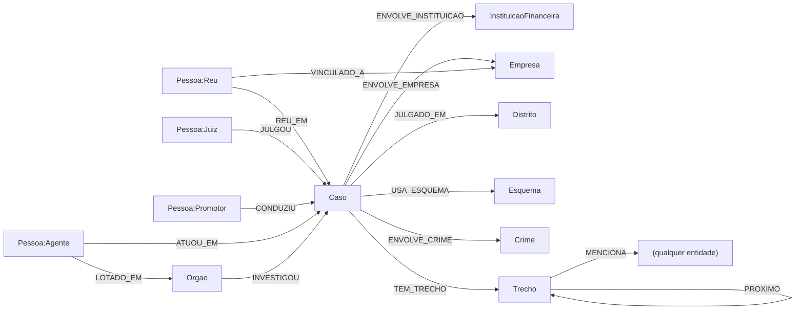

# GraphRAG / KAG — Dados Grafos (Dados Financeiros (Fraudes))

Projeto Final da disciplina **Tendências em Ciência da Computação** (UNIPÊ), prof. Ricardo Roberto.
Sistema de perguntas e respostas sobre **casos reais de fraude financeira**. O sistema usa um **grafo de conhecimento no Neo4j**, construído a partir de textos não estruturados, e busca **híbrida** (vetorial + grafo). A resposta mostra de onde veio cada informação.

**Equipe:** Max Cavalcante · Bruno Dutra · Hiago Kalil · Vitor Nóbrega · Lucas Lopes

| Fase | Conteúdo | Situação |
|---|---|---|
| **1** | Proposta, dataset, modelo LPG, schema no Neo4j | ✅ Concluída |
| 2 | Text-to-Graph: NER, extração de relações, resolução de entidades, ingestão | ⏳ Próxima |
| 3 | GraphRAG/KAG: busca híbrida, multi-hop, algoritmos, mitigação de alucinação | — |
| 4 | Interface, artigo (SBC) e apresentação | — |

---

## 1. Estudo de caso e dataset

| Item | Definição |
|---|---|
| Estudo de caso | Dados Grafos (Dados Financeiros (Fraudes)) |
| Fonte | [Department of Justice 2009–2018 Press Releases](https://www.kaggle.com/datasets/jbencina/department-of-justice-20092018-press-releases) (Kaggle, licença **CC0 – domínio público**), comunicados oficiais do Departamento de Justiça dos EUA |
| Tamanho | **13.087** comunicados, de 05/01/2009 a 27/07/2018 |
| Campos | `id`, `title`, `contents` (texto completo), `date`, `topics`, `components` |
| Recorte | **1.106** comunicados candidatos de fraude financeira |

**Por que este dataset:** são **casos reais** e o texto é **livre** (matéria-prima para NER/RE). Os textos citam réus, bancos, esquemas, órgãos investigadores, distritos, penas e valores, o que permite consultas **multi-hop**.

**Critério do recorte** (`scripts/analisar_dataset.py`): o comunicado entra se cumprir pelo menos um destes:
- tem um tópico financeiro (*Financial Fraud*, *Mortgage Fraud*, *Securities, Commodities & Investment Fraud*);
- o texto cita *bank fraud*, *Bank Secrecy Act* ou *mortgage fraud*;
- o título cita banco, lavagem, Ponzi, fraude de valores, *wire fraud*, hipoteca, empréstimo, cartão etc.

O campo `topics` está vazio em 64% dos comunicados, por isso o recorte não depende só dele. O recorte ainda tem ruído; na Fase 2 o LLM classifica cada comunicado antes da extração.

**O que o recorte contém** (contagem por padrão de texto, portanto aproximada):

| Informação | Comunicados |
|---|---|
| Valores em US$ milhões/bilhões | 747 |
| Promotor citado / juiz citado | 763 / 520 |
| FBI / IRS / SEC / HUD-FHFA | 567 / 482 / 173 / 94 |
| Confissão de culpa / denúncia / condenação | 578 / 527 / 271 |
| Coréus ou cúmplices | 528 |
| Esquema hipotecário | 330 |
| Restituição / confisco | 253 / 244 |
| Número de lei (`U.S.C.`) | **8**, raro, por isso nenhuma pergunta depende dele |

Particularidades que influenciaram o modelo: **44** comunicados sem `id` e **3** `id` repetidos. Por isso o projeto gera a própria chave (`caso_id`).

## 2. Privacidade e anonimização

- **Toda pessoa vira código:** `Reu_001`, `Juiz_001`, `Promotor_001`, `Agente_001`. A mesma pessoa recebe sempre o mesmo código.
- **Organizações mantêm o nome real:** bancos, empresas e órgãos.
- **Não são guardados** idade nem cidade de réus (risco de reidentificação).
- A tabela *nome real → código* fica **só local** (`data/private/`, no `.gitignore`). O grafo e o repositório contêm apenas códigos.

## 3. Redução de ruído na extração (aplicada na Fase 2)

1. **Filtro de relevância:** o LLM classifica o comunicado (fraude financeira: sim/não) antes de extrair.
2. **Regras onde o texto é padronizado:** regex para juízes, promotores, agentes, leis, penas e valores.
3. **Esquema fechado:** o LLM só devolve os rótulos e relações do modelo, em JSON validado.
4. **Frase de evidência obrigatória:** cada extração traz o trecho exato do texto; o código descarta o que não existir no comunicado.
5. **Resolução de entidades:** normalização de nomes de organizações; pessoas só são unificadas entre comunicados com contexto compatível.
6. **Medição:** cerca de 30 comunicados anotados à mão para calcular precisão e revocação da extração.

## 4. Perguntas que o sistema deve responder

| # | Pergunta (modelo) | Tipo |
|---|---|---|
| 1 | Quais casos envolvem o banco X? | Consulta direta |
| 2 | Quais órgãos investigaram o caso Y? | Consulta direta |
| 3 | Que outros réus cometeram fraude contra o mesmo banco do caso Y? | Multi-hop (3 saltos) |
| 4 | Que outros casos o promotor do caso X conduziu, e quais envolvem lavagem? | Multi-hop (3) |
| 5 | O Réu_NNN tem coréus que aparecem em outros casos? | Multi-hop (3–4) |
| 6 | Em quais distritos aparece fraude hipotecária investigada pelo HUD/FHFA? | Multi-hop (2–3) |
| 7 | Quais bancos aparecem em casos investigados por FBI e IRS juntos, e qual o valor total? | Multi-hop + agregação |
| 8 | Quais grupos de casos, réus e bancos existem, e qual esquema predomina em cada um? | Louvain |
| 9 | Quais bancos e órgãos são mais centrais na rede de casos? | PageRank |
| 10 | Qual o caminho mais curto entre o banco A e o banco B? | Shortest Path |
| 11 | "Casos de Ponzi contra investidores idosos": réus e penas? | Híbrida (vetor + grafo) |
| 12 | Que penas foram aplicadas em casos parecidos com o caso X? | Híbrida (vetor + grafo) |
| 13 | Como evoluiu o número de casos de lavagem por ano? | Agregação temporal |
| 14 | Qual o valor de restituição e confisco por tipo de esquema? | Agregação |
| 15 | Pergunta sem resposta no grafo (ex.: casos de 2022) | Teste anti-alucinação |
| 16 | Pergunta com premissa falsa | Teste anti-alucinação |

Na Fase 3, cada modelo vira de 2 a 3 perguntas concretas com gabarito tirado do Cypher, usadas para comparar **RAG só vetorial × GraphRAG**.

## 5. Modelo LPG



**Nós**

| Rótulo | Chave | Propriedades principais |
|---|---|---|
| `Caso` | `caso_id` | `doj_id`, `titulo`, `data`, `ano`, `topicos`, `componentes`, `texto_anon`, `valor_esquema_usd`, `embedding` |
| `Trecho` | `trecho_id` | `caso_id`, `ordem`, `texto`, `embedding` |
| `Pessoa:Reu` / `:Juiz` / `:Promotor` / `:Agente` | `codigo` | somente o código |
| `InstituicaoFinanceira` | `nome` (normalizado) | `nome_exibicao`, `aliases`, `tipo` |
| `Empresa` | `nome` | `nome_exibicao`, `aliases` |
| `Orgao` | `nome` | `sigla`, `tipo` |
| `Distrito` | `nome` | — |
| `Esquema` / `Crime` | `nome` | vocabulário controlado |

Os algoritmos gravam `comunidade` (Louvain) e `pagerank` nos nós.

**Relações**

| Relação | De → Para | Propriedades |
|---|---|---|
| `REU_EM` | Reu → Caso | `desfecho`, `pena_meses`, `restituicao_usd`, `confisco_usd` |
| `JULGOU` / `CONDUZIU` / `ATUOU_EM` | Juiz / Promotor / Agente → Caso | — |
| `LOTADO_EM` | Agente → Orgao | — |
| `INVESTIGOU` | Orgao → Caso | — |
| `ENVOLVE_INSTITUICAO` | Caso → InstituicaoFinanceira | `papel` (vítima, acusada, intermediária) |
| `ENVOLVE_EMPRESA` / `VINCULADO_A` | Caso → Empresa / Reu → Empresa | `papel` / `cargo` |
| `JULGADO_EM` | Caso → Distrito | — |
| `USA_ESQUEMA` / `ENVOLVE_CRIME` | Caso → Esquema / Crime | — |
| `TEM_TRECHO` / `PROXIMO` / `MENCIONA` | Caso → Trecho / Trecho → Trecho / Trecho → entidade | `ordem` |

**Procedência:** toda relação extraída do texto leva `evidencia` (frase exata), `trecho_id` e `metodo` (`regex` ou `llm`).

## 6. Schema no Neo4j

Arquivo: [`schema/schema.cypher`](schema/schema.cypher), com 24 comandos idempotentes.

| Tipo | Qtd. | Itens |
|---|---|---|
| Chave (`NODE KEY`) | 9 | `Caso.caso_id`, `Trecho.trecho_id`, `Pessoa.codigo`, `nome` de InstituicaoFinanceira, Empresa, Orgao, Distrito, Esquema, Crime |
| Existência | 3 | `Trecho.texto`, `Caso.titulo`, `REU_EM.evidencia` |
| Tipo | 2 | `Caso.data :: DATE`, `Caso.ano :: INTEGER` |
| **B-Tree** (no Neo4j 5 o tipo se chama `RANGE`) | 5 | `Caso.data`, `Caso.ano`, `Trecho.caso_id`, `REU_EM.desfecho`, `ENVOLVE_INSTITUICAO.papel` |
| **Fulltext** (analisador `english`) | 3 | `Trecho.texto`, `Caso.titulo`, nome das organizações |
| **Vector** (768 dim., cosseno) | 2 | `Trecho.embedding`, `Caso.embedding` |

**Validação** (`scripts/aplicar_schema.py`, rodada em banco vazio): 24/24 comandos aplicados, 14 constraints criadas, 10 índices ONLINE. As 6 tentativas de gravar dados inválidos foram recusadas (caso repetido, caso sem ID, data em texto, código de pessoa repetido entre papéis, trecho sem texto, `REU_EM` sem evidência). As buscas vetorial e fulltext funcionaram, e o banco terminou com 0 nós.

## 7. Decisões técnicas

| Item | Escolha |
|---|---|
| Banco | Neo4j **AuraDB Free** 5.27 (até 200 mil nós e 400 mil relações; apagado após 30 dias sem uso) |
| Embeddings | `intfloat/multilingual-e5-base` (768 dim., gratuito e local). Multilíngue porque as perguntas são em português e os textos em inglês |
| Certificados | `truststore` em `scripts/conexao.py`: o Python passa a validar o certificado do Aura com os certificados do sistema operacional (corrige o erro `CERTIFICATE_VERIFY_FAILED` em alguns Windows) **sem desligar a verificação** |
| LLM | Acessado por interface compatível com OpenAI, para trocar de provedor só pela configuração (definido na Fase 2) |

## 8. Como rodar

**Pré-requisitos:** Python 3.10+, e acesso à instância Neo4j do grupo (peça o arquivo de credenciais a quem administra a instância).

**Windows (duplo clique):**
1. Copie as credenciais do Aura para um arquivo `.env` na raiz (modelo em `.env.example`).
2. `setup_windows.bat`: cria o ambiente virtual, instala as dependências e testa a conexão.
3. `aplicar_schema_windows.bat`: aplica e valida o schema.

**Qualquer sistema (terminal):**
```bash
python -m venv .venv
# Windows: .venv\Scripts\activate   |   Mac/Linux: source .venv/bin/activate
pip install -r requirements.txt
python scripts/testar_conexao.py
python scripts/aplicar_schema.py
```

**Dataset:** baixe o zip do Kaggle (link na seção 1), salve como `data/raw/dataset1.zip` e rode `python scripts/analisar_dataset.py`. Os dados brutos não vão para o repositório.

Se a conexão falhar com erro de certificado, rode `diagnostico_windows.bat` (ou `python scripts/diagnostico_certificado.py`).

## 9. Estrutura

```
graphrag-fraude/
├── schema/schema.cypher          # constraints e índices
├── scripts/
│   ├── conexao.py                # conexão única com o Neo4j
│   ├── testar_conexao.py         # teste do passo 1.4
│   ├── aplicar_schema.py         # aplica e valida o schema (1.5)
│   ├── analisar_dataset.py       # números do dataset (1.1/1.2)
│   └── diagnostico_*.py          # diagnóstico de conexão
├── data/                         # fora do Git: raw/, interim/, private/
├── *.bat                         # atalhos para Windows
├── requirements.txt
└── .env.example
```

## 10. Próximos passos (Fase 2)

Classificação de relevância, extração por regras e por LLM com evidência, anonimização, resolução de entidades, chunking e embeddings, e ingestão no Neo4j com `MERGE`.
